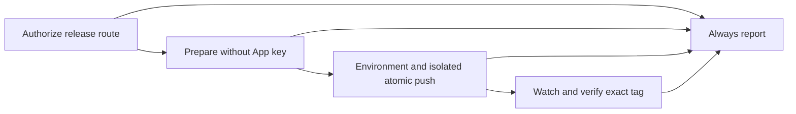

# ADR-3512: CI release authorization

Status: accepted, staged activation. Date: 2026-10-26. Issue: #3512.

## Decision

Use `release-auto.yml` to prepare releases without an App key, then transfer a
verified Git bundle to a separate push job. That job executes trusted workflow
shell and Git only, with no repository checkout, repository scripts, package
installation or shared build cache. Installation tokens request only
`contents: write` on this repository and are revoked by the pinned token action.

The RC App may bypass main review and create RC tags. The stable App may create
stable tags only, after the `release-stable` Environment reviewer approves.
Both Environments admit only main. Manual dispatch repeats its dispatcher
allowlist before preparation and minting; schedule uses event, repository, ref
and enablement checks. Input checks apply to both routes. Prepare and push reject
run attempts above one. Watch recovery rechecks the exact tag for both routes
and the dispatcher for manual runs. Stable age is
measured from the original run's `created_at`, with a 24-hour bound checked after
approval and immediately before the only push attempt. The bundle is retained
for one day for inspection; watch/report recovery reads the existing tag and
stored outputs without preparing or pushing again. Each watch rerun starts its
own bounded recovery operation; retry budgets never replenish within an operation.
Agents never dispatch stable or approve
the stable Environment. GitHub cannot distinguish a human from an agent using
the same credential; this behavioral boundary remains explicit.

The RC principal can write arbitrary contents to main if its key is stolen.
GitHub cannot constrain that bypass to metadata paths. The existing metadata
classifier protects the prepared path, not a stolen credential. The App has no
workflow-write permission. This accepts the replacement authorization boundary
requested in #3512, superseding the exclusively in-session driver of PRD-1265
and the human-only tag push of PR #947. The local scripts remain the fallback.

Before minting, the isolated Git job also enforces the cutter's fixed paths:
only modifications of `CHANGELOG.md`, `deploy/chart/Chart.yaml`,
`deploy/chart/values.yaml` and `scripts/assert-worker-tag-decoupled.sh`, plus
deletions of canonical lowercase UUID-v4 fragments in `changelog.d/`. Modified
files must keep their regular-file mode; fragment deletions require mode 100644.
No additions, renames, symlinks or directory-prefix exemptions are admitted.
The full content classifier still runs during preparation.

## Invariants

- RC commits and their annotated tags use one atomic, non-force push. Immediately
  before pushing, re-read main, release tags and peeled IDs; stop on a race.
  A metadata PR would lose the atomic main/tag transition without reducing the
  unattended merge principal's power.
- Stable is a metadata child of the explicitly pinned newest candidate. It uses
  that candidate's publication and one-hop coverage, not current-main CI.
  Advancing or red main does not change its contents. The summary lists the
  first-parent main changes observed during preparation for approval review.
- Base selection, threshold and previous publication remain in `--plan`.
  Manual RC requests may proceed through a valid no-op recommendation; the
  cutter still validates releasability. Supersede lifts only the matched latest
  failed/missing publication refusal, never pending/unreadable state or another
  guard. It cannot waive coverage, oracle, metadata, pin or adoption checks.
- Codex lock changes require the adoption read and a local cut. No model or
  attestation parsing runs in CI. Abandon uses the highest stable boundary, so
  an adopted Codex change in an abandoned train still blocks automatic abandon
  until a local cut. This is deliberate fail-closed behavior.
- A thin bundle requires its pinned parent to be fetched before verification.
  Validate digest, exact refs, release SHA, tag object and single parent before
  minting. No configuration or hooks are imported. A lost push receipt is
  recovered against the same prepared tag/SHA; never prepare a replacement.
  Prepare and push fail closed for run attempts greater than one, before minting:
  re-dispatch instead after inspecting uncertain remote state. Watch and report
  may rerun against the same existing tag/SHA; they cannot create a new tag.
  Recovery refuses an older stable when a newer stable tag exists, preventing
  a stale publication rerun from changing the latest channel.
- Preparation failure metadata uses optional, bounded cutter/oracle result files;
  raw command prose stays in logs. Watch owns receipt/publication validation.
  Report succeeds after delivering the incident and fails on reporting errors;
  it does not turn a failed upstream job green (#3551).
  An unconfirmed push receipt stops watch before publication recovery and
  verification, including automatic publication retries. Inspect remote refs,
  then use local watch/verify against the same existing tag/SHA.
  A successful promotion followed by a diagnostics-write failure exits nonzero
  and retains its local stable tag. CI does not push; inspect local and remote
  refs before recovery.

## Stages and limits

3e-1 introduced manual dispatch. Manual tip selection has 120 minutes plus 10 minutes for
cutting; publication watching retains its 60-minute bound, within a 120-minute
post-push recovery allowance and enclosing job timeouts. No morning cutoff
applies to dispatch. A single allowlisted infrastructure rerun of pre-cut main
CI cannot replenish when main moves. Unknown steps and test/assertion failures
stop. Existing non-gate publication retries retain their two-rerun budget when watch runs.

**D10 is partial until 3e-3.** Post-cut main CI recovery, infrastructure-only
tagged KinD retries and targeted `assert-tag-smoke` recovery are deferred to that
separate follow-up. The existing watcher stays fail-closed on these gates.
Its role-based retry/run/job URLs and budget are appended to the summary with a
32,768-source-byte limit and an explicit truncation marker. The full per-attempt
publication failing-step journal is also open work for 3e-3; D10 reporting is not
complete. Pre-cut CI retries already record steps, attempt and result.
Publication/verification timestamps are recorded without claiming deployment
health. Runner-slot and critical-path impact remain unmeasured until live use.

3e-2 adds opt-in scheduling after the proven live RC. Cron `47 4 * * *` uses
GitHub's native `timezone: Europe/Bucharest`, targeting a cut near 05:00 when on time, after
the local maintenance window ([schedule syntax](https://docs.github.com/en/actions/reference/workflows-and-actions/workflow-syntax#onschedule)).
Only exact `RELEASE_NIGHTLY_ENABLED=true` enables nightly attempts; unset/false
is a reported no-op. Activation requires the user's decision. Enablement is
rechecked at job boundaries; pausing may stop a not-yet-pushed attempt there,
possibly red with `nightly-disabled`. To stop an in-flight run immediately,
cancel it explicitly. Recovery of a pushed tag and manual dispatch are unaffected.
Schedule authorization
pins repository, main ref, event and original run metadata, with canonical RC
inputs only. Manual dispatch keeps the actor allowlist and input checks.
Stable remains manual.

Nightly eligibility comes only from `release-cut.sh --plan`: a non-metadata
shipping change plus releasable notes. A no-op stops before CI waiting, cutting
or artifact upload. Blocked plans are not converted into no-ops; manual empty
respins retain the cutter's rules. The provisional cutoff is strictly before
13:00 on the original run creation's Bucharest date. Tip waiting is bounded by
`min(cutoff - 600 - now, 10800)`: at most three hours, ending by 12:50 and
reserving a provisional fixed 600 seconds without resetting on tip changes.
This is the existing cutter timeout, not a measured cut duration; it is an
approved rollout deviation from D6 until timing evidence supports adjustment.
An on-time 04:47 start can wait until 07:47; a six-hour-late 10:47 start can wait
until 12:50 (7380 seconds). Eligible polling still holds a runner under the
account's 20-job cap. The prepare ceiling stays 210 minutes: 180 for waiting,
ten for cutting and 20 for setup/overhead. Manual waiting stays 7200 seconds
and its cutter budget stays 600 seconds. Push/watch ceilings remain
15/125 minutes. Exact-head CI impact and live contention remain unmeasured.
The isolated push job independently requires the enable flag and checks the
window before minting, then recomputes the window immediately before pushing.
Both inline checks require numeric epochs, a +0200/+0300 Bucharest offset and
a fail-closed comparison. Original creation time permits at most 60 seconds of
runner clock skew; the 13:00 cutoff itself has no grace period.
An expired window records `missed-target` and no attempted push. A queued run
cannot acquire a new window on the following date. Manual budgets are unchanged.
After tagging, bounded recovery ignores the cutoff and pause flag. Verification
recorded after 14:00 is marked late without changing verified success or opening
an extra incident. No clock-driven recovery cancellation or D10 journal is added.
All routes share a non-cancelling queue, bounded by GitHub's 100 pending runs. A
pending stable approval can delay RC work. A run cancelled before starting
cannot produce its own report; its Actions status remains the evidence.

The later cutoff follows observed scheduler delays of roughly six hours, not a
guaranteed platform delay. Against the E2E 01:17Z cron, runs were created at
[06:52:55Z on October 28](https://github.com/vtmocanu/uzi/actions/runs/40646564814)
and [07:10:07Z on October 29](https://github.com/vtmocanu/uzi/actions/runs/40833689917).
Against the release 02:47Z cron, the October 28 run was created at
[08:59:40Z](https://github.com/vtmocanu/uzi/actions/runs/40660797895), past the
previous 08:00 local cutoff. Delayed attempts may cut during daytime merges;
exact-tip CI can take longer to settle, but neither tip moves nor retries reset
the three-hour cap or original-date cutoff.

Before the first live dispatch, the maintainer applies and verifies the five
rulesets and Environment setup in [deploy/README.md](../deploy/README.md).
No workflow changes these settings. A real stable rehearsal requires the user's
explicit decision. Before a local fallback, finish or stop CI release work,
inspect remote main/tags and recover any interrupted publication using the same
tag. Do not race a local cut against CI.

## Related decisions

[ADR-1265](1265-rc-release-train.md) retains the RC-first train and candidate-based
promotion. [ADR-2957](2957-changelog-fragments.md) retains fragment assembly and
oracle boundaries. PR #2718's bounded metadata inheritance supersedes waiting
for the release commit's own full CI before tagging. Brew publication separately
requires the same tag's successful Release workflow.
